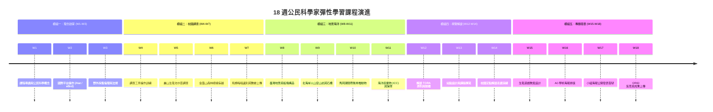

# 麗山高中高一彈性學習時間選修課程計畫書：公民科學家課程模組

本計畫書適用於 108 課綱高級中等學校「彈性學習時間」（每週 2 節，全學期 18 週，共計 36 節課），為麗山高中榮獲臺北市第 19 屆行動研究特優之「公民科學家培訓課程模組」標準開課計畫。

---

## 一、課程基本架構

| 項目 | 說明 |
| :--- | :--- |
| **課程名稱** | **彈性學習——公民科學家培訓課程** |
| **開課對象** | 高一全體學生（適性跑班自由選修） |
| **總節數** | 全學期 18 週，每週 2 節（共 36 節） |
| **主授教師** | 林獻升 老師（協同生物科教學團隊） |
| **對接課綱代碼** | 彈性學習代碼 F（充實增廣／學校特色活動／服務學習志工） |

---

## 二、18 週進度規劃 (18-Week Detailed Progress)

| 週次 | 單元主題 | 節數 | 核心內容與實作活動 |
| :---: | :--- | :---: | :--- |
| **01** | 課程導航與公民科學新典範 | 2 | 翻轉打掃服務學習，認識國內外公民科學經典案例。 |
| **02** | 數位公民科學平台實操 | 2 | 註冊並實測 iNaturalist 與 eBird，學習拍照標註與物種鑑定。 |
| **03** | 田野倫理與無痕山林 (LNT) | 2 | 五大採集守則：照片優先、即刻釋回、翻石必歸位、零帶離。 |
| **04** | 生態調查儀器與方法訓練 | 2 | GPS 定位儀、溫濕度計、樣線法 (Line Transect) 測繪技巧。 |
| **05** | 校園人工生態池水質探究 | 2 | 水質測試筆檢測溶氧、pH，觀察水生微棲地與水生昆蟲。 |
| **06** | 金面山森林步道穿越線實察 | 2 | 木山層石英砂岩、剪刀石地質與亞熱帶常綠闊葉林分層調查。 |
| **07** | 鳥類聽音辨種與物種名錄建檔 | 2 | 雙筒望遠鏡操作，辨識臺灣藍鵲、五色鳥、紅嘴黑鵯鳴叫。 |
| **08** | 臺灣地景生態與造山運動 | 2 | 大屯火山群、侵蝕堆積地形與微氣候對生物棲地之塑造。 |
| **09** | 北海岸極端環境與海岸植物 | 2 | 老梅綠石槽、安山岩風稜石、風剪樹之形態適應解碼。 |
| **10** | 潮間帶海洋生物多樣性 | 2 | 馬岡海蝕平台潮池分帶、棘皮動物管足與海藻季相變化。 |
| **11** | 海洋危機與永續海鮮倡議 | 2 | 微塑膠、過度捕撈、潮境海灣資源保育區成功治理經驗。 |
| **12** | 自然生態導覽與 TORA 原則 | 2 | 靈魂主題句提煉、日常生活隱喻運用、扇形站位訓練。 |
| **13** | 解說站點規劃與講稿撰寫 | 2 | 選定校園 4 個解說站點，編寫 3 分鐘生動轉譯講稿。 |
| **14** | 實境走讀解說定點演練 | 2 | 小組輪替駐站解說，教師與同儕進行 100 分量化評分與回饋。 |
| **15** | 體驗式生態遊戲教案設計 | 2 | 拆解「搶救棲地」、「蛇形刁手」，小組設計闖關互動遊戲。 |
| **16** | 數據可視化與 A0 學術海報排版 | 2 | 圖表繪製、圖文比例 (45/40/15) 校對、字級 24pt 規範。 |
| **17** | 公民科學專案成果發表大會 | 2 | 全班 A0 海報公開張貼口頭答辯，每組 6 分鐘評審答辯。 |
| **18** | ORID 深度反思與學習歷程認證 | 2 | 四層次反思寫作、多元表現證明核發、平臺資料上傳輔導。 |

---

## 關聯與導航
- [[高二多元選修_10週課程規劃表]]
- [[課綱核心素養與校本學生圖像對齊表]]
- [[麗山校訂課程成績評量常態分佈規準]]
