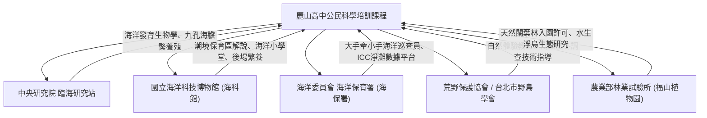

# 外部科研機構資源與專家合作網絡

麗山高中公民科學培訓課程之最大優勢，在於長年深耕並串聯國家級頂尖科研機構與非政府組織 (NGO)，為學生提供高規格之學術參訪、專家面對面與田野合作。

---

## 合作機構與資源清單

### 1. 中央研究院 臨海研究站 (宜蘭礁溪)
- **聯絡合作重點**：紫海膽胚胎受精發育觀察、九孔抗病育種實驗、頭足類行為水槽參訪。
- **教育意義**：引導學生接觸中央研究院前沿發育生物學實驗室，開啟科研視野。

### 2. 國立海洋科技博物館與潮境海洋中心 (基隆八斗子)
- **聯絡合作重點**：潮境海灣資源保育區實地走讀、珊瑚斷枝復育操作體驗、「一日所獲 海洋小學堂」教案體驗。
- **教育意義**：提供學生實境面對公眾進行口語解說演練之最佳標準場域。

### 3. 海洋委員會 海洋保育署 (海保署)
- **聯絡合作重點**：申請「海洋保育巡查員大手牽小手實施計畫」、ICC 國際淨灘數據科學回報、海洋保育教育教材支援。

### 4. 荒野保護協會 (Society of Wilderness)
- **聯絡合作重點**：自然生態解說員訓練技巧、體驗式生態遊戲（草木皆兵、搶救棲地）之教案授權與引導員培訓。

---

## 關聯與導航
- [[高二多元選修_10週課程規劃表]]
- [[核心講義重點提煉與PPT對照]]
- [[推薦圖鑑與數位公民科學工具清單]]
