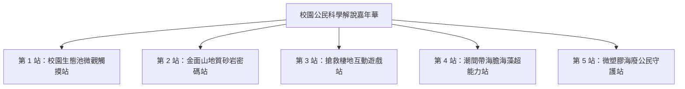

# 校園生態解說嘉年華與出隊服務學習實踐方案

本方案為公民科學培訓課程之「總結實踐閉環」，引導修課學生在學期末走出生物實驗室，於麗山校慶、開放日或社區偏鄉國小，舉辦「公民科學解說嘉年華」，將所學化為具體的公共服務。

---

## 一、活動架構與攤位模組

### 1. 站點內容設計
- **站點 1（生態池觸摸站）**：設置顯微鏡與水生觀察盒，引導學童親眼看見水蚤跳動，認識大安水蓑衣與台灣萍蓬草。
- **站點 2（金面山地質站）**：展示木山層石英砂岩標本與放大鏡，解說清代採石場興建台北城牆的人文歷史。
- **站點 3（生態遊戲闖關站）**：由高中生帶領學童進行「草木皆兵」或「蛇形刁手」大地遊戲。
- **站點 4（海洋超能力站）**：展示無毒乾燥海星、陽燧足與海藻標本，現場演練生動的比喻解說。
- **站點 5（海廢守護站）**：展示 ICC 淨灘垃圾樣本，宣導不使用一次性塑膠製品。

---

## 二、出隊志工評量與服務時數認證
- **時數核發**：全程參與籌備、佈展、現場解說與場地復原之學生，由學校正式核發「服務學習時數 8~10 小時證明書」。
- **學童回饋問卷**：收集受服務學童之滿意度與喜愛度笑臉評分，作為高中生自我反思之佐證材料。

---

## 關聯與導航
- [[高二多元選修_10週課程規劃表]]
- [[口語解說實地演練評分規準表]]
- [[學習歷程檔案上傳指引_多元表現與課程成果]]
