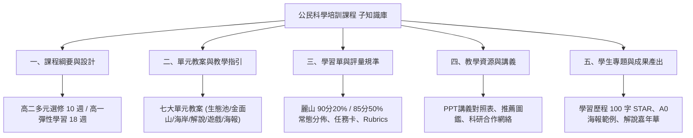

# 麗山高中公民科學培訓課程 課程子知識庫 全域主索引 (Curriculum Knowledge Map)

歡迎查閱**臺北市立麗山高級中學 生物科**「公民科學培訓課程（校本選修與彈性學習）」課程子知識庫（Curriculum Sub-Wiki）。  
本子知識庫專注於校本正式課程之開課計畫、10週/18週進度綱要、單元教案、隨堂學習單、麗山校訂課程學生成績常態分佈規準與學生學習歷程檔案（OPQN）輔導，並與母知識庫（`12生物營隊知識庫`）保持即時雙向鏈結。

---

## 🌐 三位一體立體知識網絡通道 (Tri-Wiki Navigation)

> [!NOTE]
> **本課程子庫與另外兩座知識庫緊密互聯，構成三位一體立體知識體系**：  
> 1. 🌲 **[麗山生物營隊與公民科學家母知識庫 (Master Wiki)](file:///Users/froglssh/Library/CloudStorage/GoogleDrive-frog@lssh.tp.edu.tw/我的雲端硬碟/12生物營隊/生物營隊知識庫/index.md)**：10年營隊大歷史、野外實察路線、專案經費核銷、安全與野外急救防護網。
> 2. 🏆 **[公民科學家 課程發表與得獎子知識庫 (Awards Wiki)](file:///Users/froglssh/Library/CloudStorage/GoogleDrive-frog@lssh.tp.edu.tw/我的雲端硬碟/09課程發表/1公民科學家/index.md)**：天下文化未來100、全國 KDP 國際認證、臺北市行動研究雙特優、優質化嘉年華巨幅海報展與優質學校論述。

---

## 🧭 課程知識庫五大核心維度導航

---

### 一、課程綱要與設計 (Course Syllabus & Design)
| 筆記名稱 | 核心內容與適用規範 | 關鍵對齊 |
| :--- | :--- | :--- |
| [[高二多元選修_10週課程規劃表]] | 填報麗山官方選修計畫書（週四 5-7 節，共 10 週，2 學分，選課代號 F29，林獻升老師） | 官方會議格式、112-2 行事曆 |
| [[高一彈性學習_18週課程計畫書]] | 108 課綱彈性學習時間（每週 2 節，全學期 18 週，共 36 節）標準化選修課綱 | 彈性學習代碼 F |
| [[課綱核心素養與校本學生圖像對齊表]] | 三面九項核心素養對齊麗山四大校本圖像（科學力、築夢力、跨界力、公民力） | 學校評鑑指標、校本願景 |
| [[課程設計理念與先備能力檢核]] | 開課哲學、PBL 做中學教學策略、學生選課適性自我檢核清單 | 理念闡述、先備要求 |

---

### 二、單元教案與教學指引 (Modular Unit Plans)
| 筆記名稱 | 單元主題與節數 | 核心探究與實作亮點 |
| :--- | :--- | :--- |
| [[單元一_公民科學與環境倫理]] | 理念啟蒙 (3hr) | 翻轉打掃服務學習、iNaturalist / eBird 平台操作、野外採集五大倫理 |
| [[單元二_校園微型生態調查法]] | 工具操作 (3hr) | GPS 定位、溫濕度計、水質測試筆校正、麗山人工生態池微環境檢測 |
| [[單元三_臺灣地景與海岸多樣性]] | 地景地貌 (3hr) | 大屯火山安山岩、老梅綠石槽、麟山鼻風稜石、風剪樹逆境適應 |
| [[單元四_潮間帶與海洋保育實務]] | 海洋生態 (3hr) | 馬岡海蝕平台潮池分帶、棘皮動物管足、望海巷潮境海灣資源保育區 |
| [[單元五_生態導覽與口語轉譯藝術]] | 解說實務 (3hr) | TORA 原則（主題、組織、共鳴、生動）、扇形站位、3分鐘定點導覽 |
| [[單元六_體驗式生態遊戲教案設計]] | 遊戲化 (3hr) | 搶救棲地、蛇形刁手、草木皆兵教案拆解與小組自編闖關遊戲 |
| [[單元七_學術海報製作與公開發表]] | 成果發表 (3hr) | A0 直式海報排版 (45/40/15)、圖表可視化、公開口頭發表計時答辯 |

---

### 三、學習單與評量規準 (Assessment & Rubrics)
| 筆記名稱 | 規準類型 | 核心評量指標 |
| :--- | :--- | :--- |
| [[麗山校訂課程成績評量常態分佈規準]] | **學期成績硬性規範** | **90 分以上 ≤ 20%、85 分以上 ≤ 50%**，GPA 積分與等第對照表 |
| [[課堂任務卡與實察學習單彙編]] | 隨堂形成性評量 | iNaturalist試採單、生態池水質調查單、金面山樣線穿越單 |
| [[口語解說實地演練評分規準表]] | 實務技能考核 | 100 分量化規準（TORA、科學性、感染力、隊形控時）與回饋便籤 |
| [[A0學術海報同儕互評規準表]] | 總結性學術答辯 | 版面比例 (45/40/15)、數據邏輯、台風表達、現場答辯四大向度 |

---

### 四、教學資源與講義 (Teaching Resources)
| 筆記名稱 | 資源類型 | 主要內容 |
| :--- | :--- | :--- |
| [[核心講義重點提煉與PPT對照]] | 備課指引 | 自編講義頁碼與官方 7 大 PPT 投影片關鍵圖表對照手冊 |
| [[推薦圖鑑與數位公民科學工具清單]] | 工具庫 | iNaturalist、eBird、Merlin、臺灣野鳥手繪圖鑑、潮間帶圖鑑清單 |
| [[外部科研資源與專家合作網絡]] | 學術網絡 | 中研院臨海站、國立海洋科技博物館、海保署、荒野保護協會 |

---

### 五、學生專題與成果產出 (Student Portfolios)
| 筆記名稱 | 成果類型 | 輔導要點 |
| :--- | :--- | :--- |
| [[學習歷程檔案上傳指引_多元表現與課程成果]] | **升學輔導** | 100 字 STAR 寫作公式、N 代碼課程成果、F 代碼多元表現、OPQ 反思自述 |
| [[學生優秀A0海報與專題成果範例]] | 典範觀摩 | 《馬岡潮池微環境對棘皮動物之影響》、《金面山人為踩踏衝擊》解析 |
| [[校園生態解說嘉年華出隊實踐方案]] | 社會實踐 | 學期末校慶與偏鄉學童解說服務學習 5 大攤位規劃與時數認證 |

---

## ⚙️ 系統規範與工具 (Meta)
- 規範與 Schema 定義：[[wiki-rules]]
- 時間軸日誌：[[log]]
- 教學工作助理：[[SKILL]]
